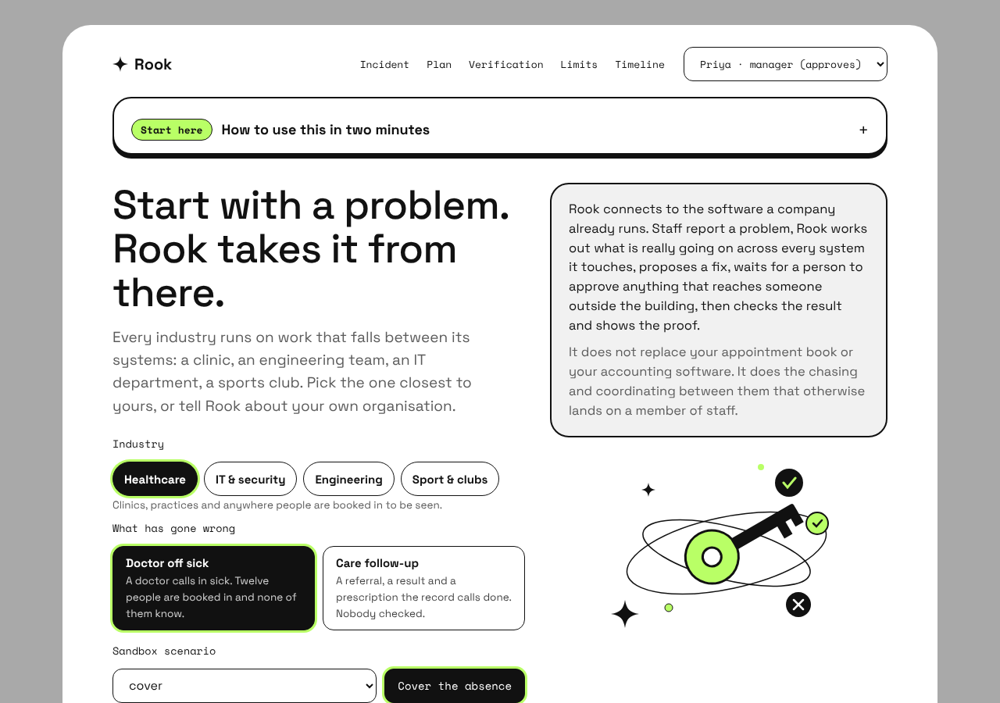
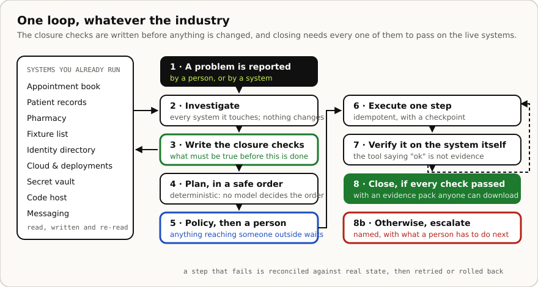
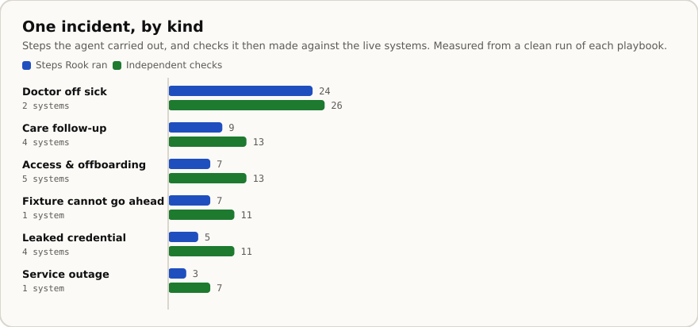
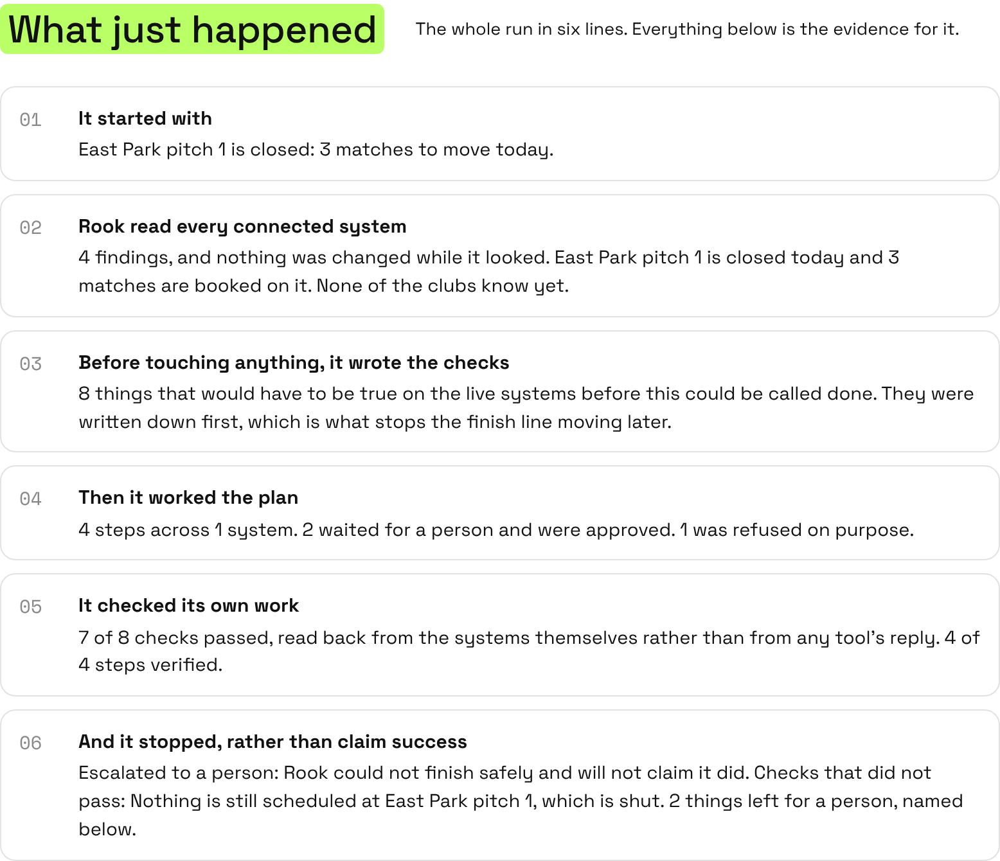
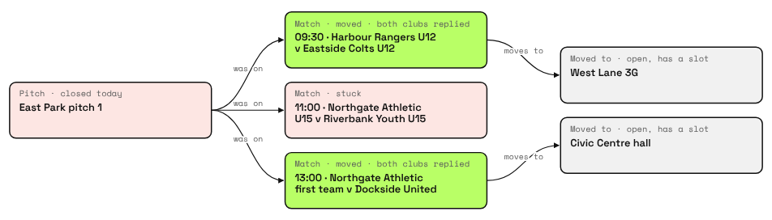
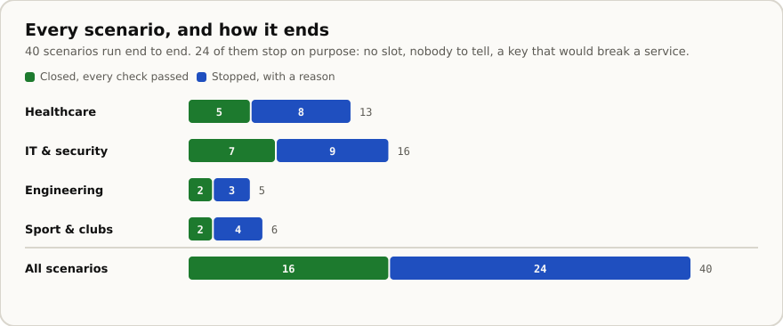
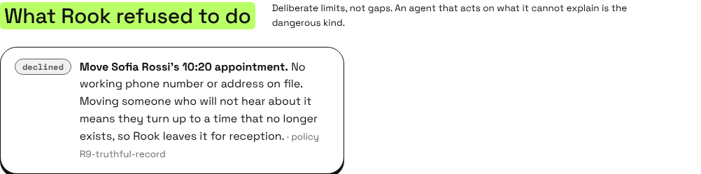
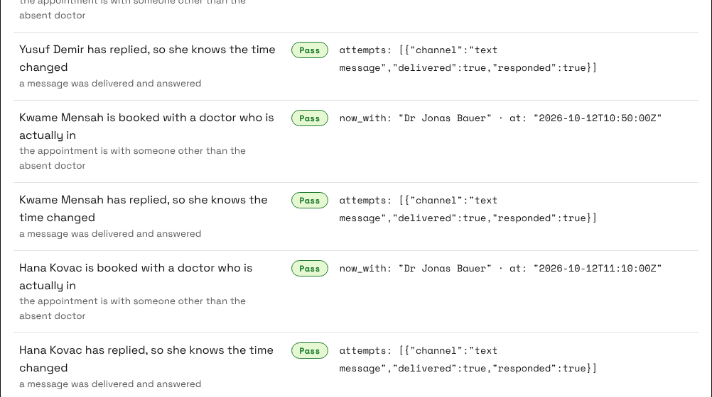
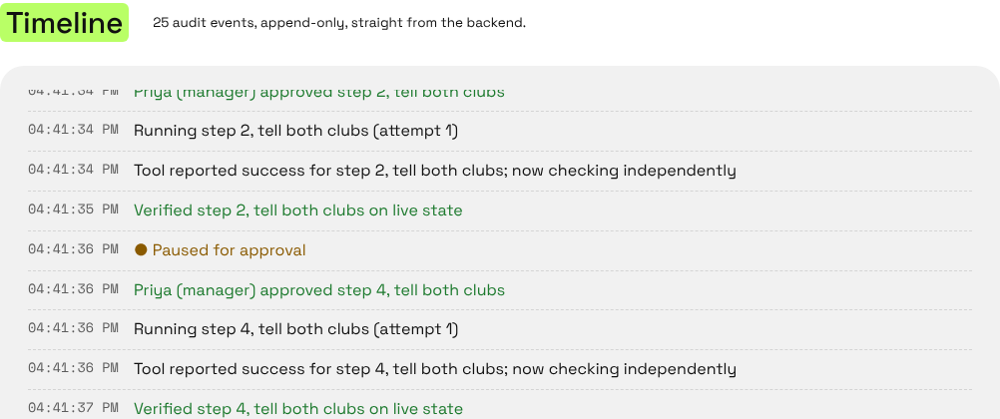
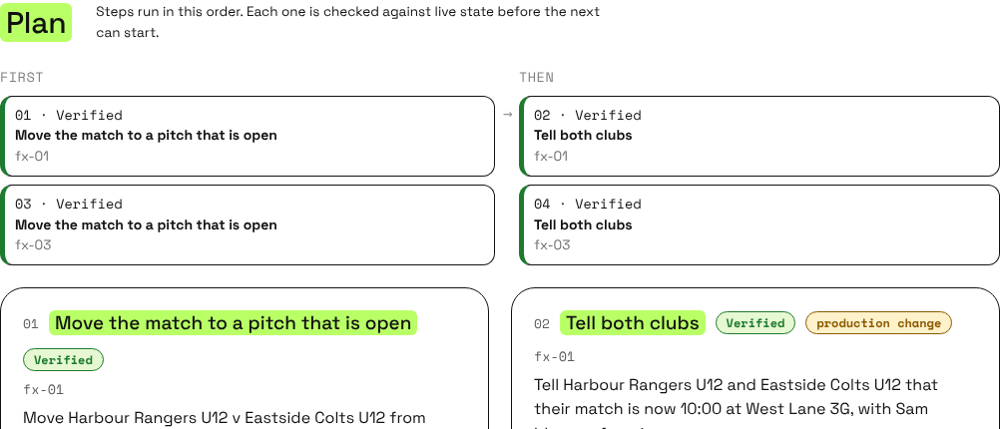

<h1>Rook</h1>

**The operations agent that proves the fix.**

Staff report a problem. Rook works out what is really going on across every system it touches,
proposes a fix, waits for a person to approve anything that reaches someone outside the
organisation, then checks the result against those systems and shows the proof. Anything it could
not finish stays open, named, with the reason.

**[rook-keywarden.pages.dev](https://rook-keywarden.pages.dev)** — the front page, with the
waitlist. **[Open the demo →](https://rook-keywarden.pages.dev/app/)** — no sign-up, straight into a
real incident. Six playbooks across four industries · 40 scenarios · 221 tests



> Every system Rook connects to in this repository is a **sandboxed mock** with synthetic data and
> synthetic credentials (`sk_test_SYNTH_*`). No real patient, clinic, club, repository or cloud
> account is touched. Built by the Keywarden team for neatHack 2026; not production-ready.

---

## The gap it closes

Most agents in this space stop at a recommendation, and say why: nobody can prove the fix worked.
Rook closes an incident only when independent checks pass on the live systems. We call that
**Verified Closure**. It does not replace a clinic's appointment book, a club's fixture list or a
company's accounting software — it does the chasing between them that otherwise lands on a member
of staff.

**What a company is buying**

- One place to see the problems nobody has finished yet.
- Connections into the software it already runs.
- An agent that investigates and coordinates the work across all of them.
- Approval controls, an audit trail, and proof the work actually landed.

## How it works



The loop is the same for every incident. A playbook (`rook/playbooks.py`) supplies only what
differs: the trigger, what to read, the plan and the closure checks.

## Four industries, one engine

| Industry | Playbook | The problem | Steps · checks |
|---|---|---|---|
| **Healthcare** | Doctor off sick | A doctor is unavailable and a day of patients is booked in with them | 24 · 26 |
| **Healthcare** | Care follow-up | Referrals, results and prescriptions the record calls done that never happened | 9 · 13 |
| **IT & security** | Access & offboarding | Someone left, but their accounts and API keys live on | 7 · 13 |
| **IT & security** | Leaked credential | A scanner found a live key hardcoded in a repository | 5 · 11 |
| **Engineering** | Service outage | A production service started failing right after a change | 3 · 7 |
| **Sport & clubs** | Fixture cannot go ahead | A pitch is shut with matches on it, six clubs and three referees | 7 · 11 |



Numbers measured by running each playbook, not typed in: `python3 scripts/make-readme-charts.py`
redraws both charts from a live run.

## After a run, in six lines



Trace tools in this space show a tree of spans and leave you to assemble the account yourself.
This is the account, with the tree underneath it. Every number in it comes from the same report
the panels below are built from, so the story and the evidence cannot disagree.



The map is the same one Rook drew while investigating, with what changed written on it: green is
done and checked, red is the problem or something deliberately left alone, grey is untouched. Every
status on it is read back from the system it lives on.

## The refusals are the product



Of the 40 scenarios, 24 end without closing — and that is the point. No slot free, nobody who can
be told, a key whose revocation would break a live service, a referee who is not available. Rook
leaves those alone, names them, and hands them to a person:



Each refusal cites the rule that produced it. The policy rules (`rook/policy.py`) are deterministic
code, not a prompt: an allowlist of action types, ownership, dependency and safe-order checks,
approval for anything irreversible or outward-facing, a known-good rule for rollbacks, a rule that
forbids marking a record "done" while anything is missing, and per-subject matching so one person's
care or one fixture's clubs can never be changed under another's.

## Proof, not a report



Every check is read back from the system itself — authentication probes, health and error rates, a
synthetic order, the appointment book, the pharmacy's queue, the specialist clinic's inbox, the
fixture list. A tool replying "ok" counts for nothing on its own. The evidence pack
(`/api/incidents/{id}/evidence`) carries the plan, the approvals, every check with its observed
evidence, what Rook refused to do, the follow-ups, and a hash-chained audit log.

## Nothing is called done on a tool's say-so



The audit log is append-only and hash-chained, and it names steps and people the way the plan does.
Note the pair that repeats all the way down: *the tool reported success* and then *verified on live
state*. The second one is the only one that counts.

## The plan, as the engine holds it



Columns are dependency depth, computed from the same `depends_on` the engine orders execution by.
What can run at the same time sits in the same column.

## Your own organisation, in your own words

The scenarios are written in advance. You do not have to use them. Under **Tell Rook about your own
organisation** the dashboard takes your clinic or company name, what you do, who is away, who could
cover, your numbers, and what you are reporting in your own words. The incident title, every step of
the plan, the approval requests, the refusals and the evidence pack then come back about you,
because Rook builds those sentences from the state rather than from a script.

```bash
curl -X POST https://<your-service>/api/incidents \
  -H 'Authorization: Bearer demo-analyst-token' -H 'Content-Type: application/json' \
  -d '{"scenario":"cover_clean",
       "reported":"Dr Mensah called in sick. Full list this morning and nobody has told the patients.",
       "setup":{"organisation":"Riverside Family Practice",
                "we_do":"Two GP surgeries in Leeds, about 9,000 patients",
                "person_away":"Dr Kofi Mensah","colleagues":["Dr Ruth Adeyemi","Dr Tom Hale"],
                "who_reports":"Grace Boateng","who_approves":"Dr Amina Yusuf",
                "people_booked_in":7,"cover_slots":2,"people_we_cannot_reach":1,"one_step_fails":true}}'
```

Every field is bounded, text must be plain (no control characters and nothing that reads as markup),
and unknown fields are refused, so describing your organisation cannot ask the service for data it
does not have or carry anything but a name into somebody's evidence pack. `who_reports` and
`who_approves` put your people's names on the sign-in menu; they are names only, and who may approve
is still decided by the token the agent checks on every request.

## Run it

Requirements: Python 3.10 to 3.13 (neatlogs does not support 3.14 yet) and Node 18 or later.
**On Ubuntu/WSL, run `./scripts/setup-wsl.sh` once, then `./scripts/dev.sh` (local) or
`./scripts/share.sh` (public link).**

```bash
# 1. Terminal demo, no server
pip install -r requirements.txt
python -m rook.demo --scenario signature

# 2. API + dashboard
uvicorn rook.api:create_app --factory --port 8000
cd web && npm ci && npm run dev          # front page http://localhost:3000, demo at /app/

# 3. One container
docker build -t rook . && docker run --rm -p 8000:8000 rook

# 4. Tests
python -m pytest -q                      # 221 tests
```

<details>
<summary><b>Deploying it, and keeping the link alive</b></summary>

```bash
ROOK_API_ORIGIN=https://<service>.onrender.com ./scripts/deploy-keepwarm.sh   # cron worker, agent never sleeps
ROOK_API_ORIGIN=https://<service>.onrender.com ./scripts/deploy-pages.sh      # upload the dashboard, no Git build
python3 scripts/check-live.py https://<project>.pages.dev                     # run a real incident against the live site
```

`deploy-pages.sh` is a direct upload: none of the Cloudflare dashboard's build settings apply, so
none of them can get it wrong. `check-live.py` wakes the agent, loads the dashboard, runs an
incident through to Verified Closure and prints `PASS`. The dashboard also detects a sleeping agent
and waits for it rather than showing an error.

</details>

<details>
<summary><b>The two pages, and signing in</b></summary>

`/` is the front page: what Rook is, who it is for, and a waitlist. `/app/` is the demo, which
needs no account. Opening the demo asks **who do you want to be** before anything else, because
what you are allowed to do here depends on the answer and a dropdown in the corner does not say so.

The waitlist is the one place this service holds anything about a real person. One required field,
everything else optional and bounded, rate limited per address, stored once per email, and there is
no route that reads it back out.


Sign-in is coming soon. For now the dashboard has four demo identities in the top-right menu, and
whoever you pick decides what you may do: staff can start an incident, only a manager can approve a
step that reaches someone outside the organisation, a read-only viewer can do neither, and someone
from another company cannot see the incident at all — it returns 404, not "forbidden". That is not
cosmetic: identity, organisation and role come from the bearer token the agent checks on every
request, never from anything the page sends.

</details>

<details>
<summary><b>All 40 scenarios</b></summary>

**Access & offboarding:** `signature`, `clean`, `ambiguous_applied`, `ambiguous_lost`, `persistent`,
`permission_denied`, `revoke_noop` (the vault says the key is revoked but it still works),
`replacement_invalid`, `faulty_update`, `regression_fail`, `vault_down` (no replacement can be
issued, so the live key is never revoked).

**Service outage:** `outage` (the rollback times out but did land), `outage_clean`,
`outage_wrong_cause` (the rollback does not fix it), `outage_rollback_down`, `outage_pause_denied`
(auto-deploy cannot be paused, so Rook will not roll back into a pipeline that would undo it).

**Leaked credential:** `leak`, `leak_clean`, `leak_already_revoked` (the key is already dead, so
rotating it would be pointless churn), `leak_unattributed` (no owner, so Rook will not touch it),
`leak_rotation_stuck`.

**Care follow-up:** `referral_clean`, `referral`, `referral_critical` (one result is urgent, so a
doctor is alerted and nothing else is touched), `referral_unreachable`, `referral_pharmacy_down`,
`referral_all_good` (everything really was done, so Rook closes with no actions at all).

**Doctor off sick:** `cover_clean` (12 appointments, all moved and everyone told), `cover` (one move
fails and is reconciled), `cover_short`, `cover_half`, `cover_unreachable` (one patient has no
working number, so her appointment stays put), `cover_nobody_reachable`, `cover_message_fails`.

**Fixture cannot go ahead:** `fixtures_clean`, `fixtures`, `fixtures_short`, `fixtures_unreachable`
(a club's group chat is dead), `fixtures_no_official`, `fixtures_washout` (every pitch shut, so
nothing moves at all).

`tests/test_all_scenarios.py` runs every one of them end to end and checks what must hold whatever
happened: the closure checks were written before anything changed, the audit chain is intact, closed
means every mandatory check passed with nothing unresolved, and not closed means a stated reason.

</details>

<details>
<summary><b>The old problems, and how Rook handles each</b></summary>

| The usual problem | What Rook does | Where |
|---|---|---|
| Offboarding disables the person but leaves their keys and side accounts alive | Starts from the closed offboarding ticket and sweeps the directory, three account systems and the vault | `playbooks.investigate` |
| Nobody knows everything that uses a key, and the vault's records are incomplete | Scans live app and cloud config by key fingerprint, and finds `payments-worker`, which the vault never listed | `sandbox.dependents_of_fp` |
| Rotating a key causes an outage | Issues the replacement first, moves every service, verifies each one and revokes last. The order is enforced in code | `engine.enforce_order`, policy R4 |
| A botched update takes a service down mid-incident | Rolls that service back to the old, still-valid key and holds the revocation | `Engine._compensate`, policy R7 |
| An outage alert fires and people spend the first half hour working out what changed | Lines the alert up against deploy history and config diffs, and names the suspect revision and the database it cannot reach | `playbooks.investigate_outage` |
| A manual rollback gets overwritten by auto-deploy | Pauses the pipeline before rolling back, and refuses to roll back while auto-deploy would undo it | policy R4 |
| "We rolled back, so it's fixed" | Closure needs the service healthy, errors normal, callers healthy and a synthetic order placed | `verification.outage_conditions` |
| Rolling back to a revision nobody trusts | Rolls back unattended only to a revision with a healthy track record. Anything else needs an approver | policy R8 |
| Scripts retry blindly and double-apply, or give up silently | Every failure is checkpointed and the real state inspected before a retry. Retries are bounded, then Rook escalates | `Engine._step` |
| The tool said "success" and the ticket was closed | Closure is decided by independent probes, never by the tool's reply | `verification.py` |
| A patient is moved to a new time nobody told them about | A move only happens where there is a slot and a way to tell them. Otherwise the appointment stays and reception is told why | `playbooks.ClinicCover` |
| The record says the referral was sent, so nobody checks | Rook asks the clinic, the pharmacy and the doctor it was meant to reach, and refuses to mark the record done while anything is missing | policy R9 |
| Orphaned accounts nobody owns | Flagged for a person. Rook never acts on access it cannot attribute | `follow_ups` |

</details>

## Architecture

```
web/ (Next.js)  ──/api proxy──▶  rook/api.py (FastAPI, bearer auth, org scoping, rate limits)
                                     │
                                     ▼
                          rook/engine.py  investigate → conditions → plan → policy
                          │      │        → execute → reconcile → verify → close/escalate
                          │   rook/playbooks.py  doctor off sick, care follow-up, fixtures,
                          │                      offboarding, outage, leaked key
             rook/policy.py  rook/verification.py (independent observers)
                          │
                rook/sandbox.py  11 stateful mock adapters, idempotency, failure injection
                          │
                rook/store.py    SQLite: incidents, actions, conditions, checkpoints,
                                 tool_calls, approvals, run leases, append-only audit
                rook/obs.py      spans → neatlogs (OpenTelemetry), redacted
```

| Adapter | What it holds |
|---|---|
| Source host | accounts, repos, commit audit log |
| Cloud | accounts, services with env vars, revisioned deployments, pipelines, databases |
| Internal app | identity directory, app config, health, regression, synthetic checkout |
| Project tracker | offboarding tickets, monitoring alerts, incident tickets |
| Vault | versioned credentials |
| Records | a clinic's own record system: orders, results, acknowledgements |
| Booking | the specialist clinics' scheduling systems, which the referrer cannot see |
| Pharmacy | what the pharmacy actually received and dispensed |
| Outreach | messages to patients, and whether anyone answered |
| Schedule | the appointment book: doctors, today's list, free slots |
| League | a club's fixtures, pitches, officials and team contacts |

Key safety properties are in [evidence/security-notes.md](evidence/security-notes.md).

## Partner tools

- **neatlogs** — one session per incident, with typed guardrail, tool and retriever spans. Every
  phase is a span (`incident.run` WORKFLOW, `investigate`/`plan` AGENT, `policy.*`/`verify`/
  `closure.evaluate` GUARDRAIL, `execute` TOOL, `reconcile`/`checkpoint.restore` CHAIN), and each
  root span carries the opening message and the final verdict in plain language. Secret values are
  never included. [Evidence](evidence/neatlogs-traces.md).
- **cfo.ai** — the business behind Rook as a sheet of named assumptions: pricing against measured
  value, cost to serve (zero inference, ~52 spans per incident), the year-one build, break-even at
  22 clinics, and the one assumption that decides it.
  [The plan](https://cfo.ai/s/D9MnZeXwqy0WpZeV) · [the inputs](evidence/cfo-ai-business-plan.md).
- **Entire** — records the agent coding sessions that built Rook as checkpoints linked to commits.
  [How to inspect them](evidence/entire-workflow.md).
- **Cloudflare** — Pages serves the dashboard and forwards `/api/*` through a Pages Function to the
  agent on Render (`render.yaml`). A Worker on a cron trigger (`deploy/keepwarm`) keeps that agent
  awake so the public link answers immediately. [deploy/README.md](deploy/README.md).

## Limitations

- The adapters are in-process mocks. No real GitHub, cloud, vault, clinic or club is called.
- Demo bearer tokens are built in for local use. Set `ROOK_TOKENS` (JSON) and `ROOK_DEMO_TOKENS=0`
  anywhere shared.
- There is a single shared sandbox, so only one incident runs at a time.
- The optional model planner (`ROOK_PLANNER=llm`) covers the offboarding playbook and only proposes
  actions. Ordering, policy and verification stay deterministic.
- Six playbooks so far, across four industries. Each new incident type is a new playbook plus the
  adapter operations it needs.
- The clinic playbooks are administrative only. Rook chases paperwork and contacts people; it never
  reads a result clinically or decides care, and anything urgent goes straight to a doctor.
- The control mapping in the evidence pack is indicative: a starting point to confirm with an
  auditor, not a claim that an audit would pass.
